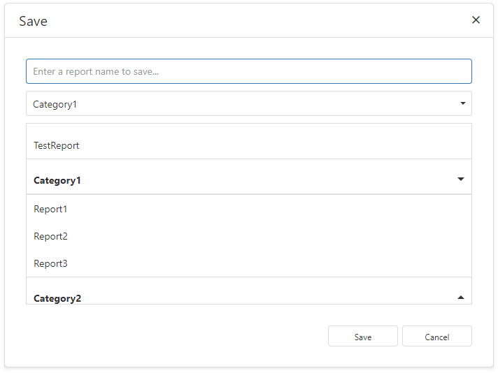
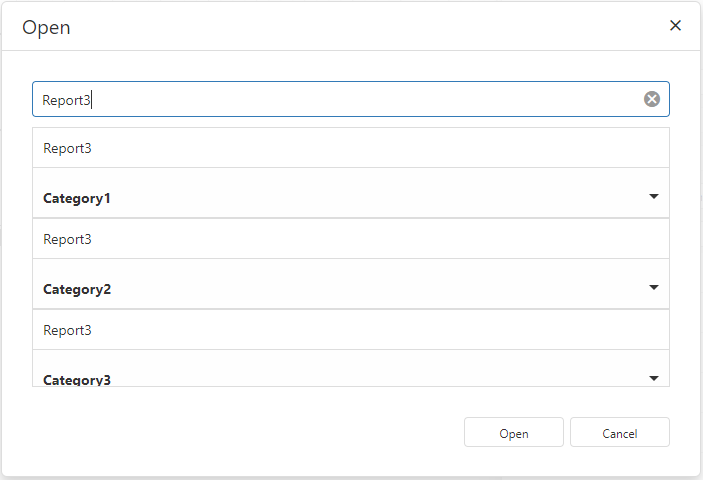

<!-- default badges list -->

[](https://supportcenter.devexpress.com/ticket/details/T897601)
[](https://docs.devexpress.com/GeneralInformation/403183)
[](#does-this-example-address-your-development-requirementsobjectives)
<!-- default badges end -->
# ASP.NET Core Reporting - Customize the Save As and Open Dialogs in the Web Report Designer

This example customizes the Web Report Designer's **Save As** and **Open** dialogs to organize reports into categories. Users can save reports in existing or new categories and search for reports in a grouped list.

## Customized Dialogs

### Save As

Open the Report Designer menu and select **Save As**. Enter a report name and select a category from the dropdown, or enter a new category name. Select **none** to save without a category. To overwrite an existing report, click its row to fill in its name and category, and click **Save**.



### Open

Open the Report Designer menu and select **Open**. Enter text to filter report paths, click a report row, and click **Open**.

Category headers only expand or collapse groups.



## Implementation Details

### 1. Register Report Storage

Register the custom [`ReportStorageWebExtension`](https://docs.devexpress.com/XtraReports/DevExpress.XtraReports.Web.Extensions.ReportStorageWebExtension) in [`Program.cs`](AspNetCoreReportingDialogCustomization/Program.cs):

```csharp
builder.Services.AddScoped<ReportStorageWebExtension, CustomReportStorageWebExtension>();
```

[`CustomReportStorageWebExtension.cs`](AspNetCoreReportingDialogCustomization/Services/CustomReportStorageWebExtension.cs) implements the storage operations:

- `GetUrls` returns report paths from the `Reports` folder and predefined reports from [`ReportsFactory.cs`](AspNetCoreReportingDialogCustomization/PredefinedReports/ReportsFactory.cs).
- `GetData` loads a report layout.
- `SetData` saves a layout and creates a category folder when needed.
- `SetNewData` delegates to `SetData` and returns the saved report URL.

Each folder in the `Reports` folder is a report category. The folder name is the category name.

### 2. Handle Dialog Customization Events

Assign handlers to [`CustomizeSaveAsDialog`](https://docs.devexpress.com/XtraReports/DevExpress.AspNetCore.Reporting.ReportDesigner.ReportDesignerClientSideEventsBuilder.CustomizeSaveAsDialog(System.String)) and [`CustomizeOpenDialog`](https://docs.devexpress.com/XtraReports/DevExpress.AspNetCore.Reporting.ReportDesigner.ReportDesignerClientSideEventsBuilder.CustomizeOpenDialog(System.String)) in [`Index.cshtml`](AspNetCoreReportingDialogCustomization/Views/Home/Index.cshtml):

```cshtml
@(Html.DevExpress().ReportDesigner("reportDesigner")
    .Height("1000px")
    .Bind(@"Category1\Report1")
    .ClientSideEvents(configure => {
        configure.CustomizeSaveAsDialog("customizeSaveAsDialog");
        configure.CustomizeOpenDialog("customizeOpenDialog");
    }))
```

These methods assign JavaScript functions as handlers of the client-side [`CustomizeSaveAsDialog`](https://docs.devexpress.com/XtraReports/js-ASPxClientReportDesigner?p=netframework#js_aspxclientreportdesigner_customizesaveasdialog) and [`CustomizeOpenDialog`](https://docs.devexpress.com/XtraReports/js-ASPxClientReportDesigner?p=netframework#js_aspxclientreportdesigner_customizeopendialog) events.

Each handler sets popup properties and calls the `e.Customize` method to replace the dialog content. For example, the Open dialog handler contains these calls:

```javascript
e.Popup.width = 700;
e.Popup.height = 476;
e.Popup.title = "Open";
e.Customize("custom-open-dialog", model);
```

See [`Index.cshtml`](AspNetCoreReportingDialogCustomization/Views/Home/Index.cshtml) for the complete handlers and models.

### 3. Define Templates and Load Categories

The HTML templates in [`Index.cshtml`](AspNetCoreReportingDialogCustomization/Views/Home/Index.cshtml) contain DevExtreme editors:

- [`dxTextBox`](https://js.devexpress.com/Documentation/ApiReference/UI_Components/dxTextBox/) accepts a report name or search text.
- [`dxSelectBox`](https://js.devexpress.com/Documentation/ApiReference/UI_Components/dxSelectBox/) selects or creates sa category in the Save As dialog.
- [`dxList`](https://js.devexpress.com/Documentation/ApiReference/UI_Components/dxList/) displays reports grouped by category.

The `updateCategories` function calls the client-side [`ReportStorageWeb.getUrls`](https://docs.devexpress.com/XtraReports/js-ASPxClientReportDesigner?p=netframework#js_aspxclientreportdesigner_reportstoragegeturls) method. This method gets report URLs from the server-side [`ReportStorageWebExtension.GetUrls`](https://docs.devexpress.com/XtraReports/DevExpress.XtraReports.Web.Extensions.ReportStorageWebExtension.GetUrls) method. The function then transforms the returned paths into the grouped array expected by `dxList`:

```javascript
[
    {
        key: "Category1",
        items: [
            {
                text: "Category1\\Report1",
                displayName: "Report1"
            }
        ]
    }
]
```

The group with an empty `key` contains reports without a category, including predefined reports.

The dialog models use ordinary JavaScript properties, not Knockout observables. The templates retain `data-bind` attributes for internal rendering. Editor event handlers synchronize model values, and widget `option` calls refresh report lists and category choices.

### 4. Connect Dialog Actions

Each model implements `setUrl`, `getUrl`, and `onShow`. The `onShow` function resets dialog state and reloads categories when the dialog opens.

The custom buttons call the popup's [`save`](https://docs.devexpress.com/XtraReports/js-DevExpress.Reporting.Designer.Tools.SaveAsReportDialog?p=netframework#js_devexpress_reporting_designer_tools_saveasreportdialog_save_url_), [`open`](https://docs.devexpress.com/XtraReports/js-DevExpress.Reporting.Designer.Tools.OpenReportDialog#js_devexpress_reporting_designer_tools_openreportdialog_open_url_), and [`cancel`](https://docs.devexpress.com/XtraReports/js-DevExpress.Reporting.Designer.Tools.ReportDialogBase#js_devexpress_reporting_designer_tools_reportdialogbase_cancel) methods:

```javascript
// Save As dialog: save the report under the category and name the user entered.
e.Popup.save(getReportUrl());

// Open dialog: open the selected report.
e.Popup.open(model.reportUrl);

// Either dialog: close without saving or opening a report.
e.Popup.cancel();
```

## Files to Review

- [Index.cshtml](AspNetCoreReportingDialogCustomization/Views/Home/Index.cshtml)
- [CustomReportStorageWebExtension.cs](AspNetCoreReportingDialogCustomization/Services/CustomReportStorageWebExtension.cs)
- [ReportsFactory.cs](AspNetCoreReportingDialogCustomization/PredefinedReports/ReportsFactory.cs)
- [Program.cs](AspNetCoreReportingDialogCustomization/Program.cs)

## Documentation

- [End-User Report Designer Customization (ASP.NET Core)](https://docs.devexpress.com/XtraReports/400278/web-reporting/asp-net-core-reporting/end-user-report-designer-in-asp-net-applications/customize-the-report-designer)
- [Use Custom HTML Templates](https://docs.devexpress.com/XtraReports/403960/web-reporting/general-information-on-web-reporting/use-custom-html-templates)

## More Examples

- [ASP.NET Core Reporting - Best Practices](https://github.com/DevExpress-Examples/AspNetCore.Reporting.BestPractices)
- [Custom Report Parameter Types in Web Reporting Controls (ASP.NET Core)](https://github.com/DevExpress-Examples/Reporting-Custom-Parameter-Editor-AspNet-Core)
- [Web Reporting (ASP.NET MVC, ASP.NET Core and Angular) - How to Customize the DevExpress Report Wizard Customization and Hide Data Source Actions within the DevExpress Report Designer](https://github.com/DevExpress-Examples/reporting-web-wizard-customization-service)

<!-- feedback -->
## Does This Example Address Your Development Requirements/Objectives?

[](https://www.devexpress.com/support/examples/survey.xml?utm_source=github&utm_campaign=reporting-asp-net-core-customize-open-and-save-as-dialogs&~~~was_helpful=yes) [](https://www.devexpress.com/support/examples/survey.xml?utm_source=github&utm_campaign=reporting-asp-net-core-customize-open-and-save-as-dialogs&~~~was_helpful=no)

(you will be redirected to DevExpress.com to submit your response)
<!-- feedback end -->
